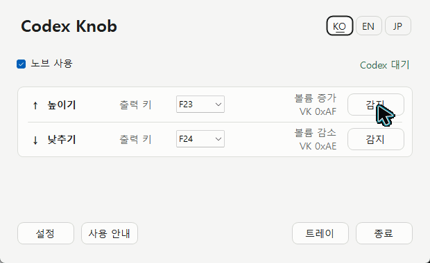
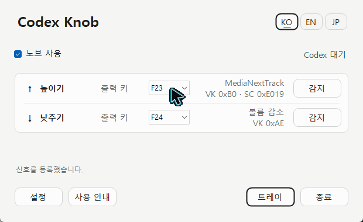

# Codex Knob

Turn a keyboard knob to adjust reasoning effort in Codex on Windows. Input is remapped while the Microsoft Store version of Codex is in the foreground.

[한국어](README.md) · English

## Install

[Download Setup for Windows x64](https://github.com/Gabeujin/codex-knob/releases/download/v1.2.0/Codex-Knob-1.2.0-Setup-x64.exe)

1. If Codex Knob is running, choose **Quit** from the tray menu.
2. Run Setup. If .NET Framework 4.8 or later is missing, Setup downloads the Microsoft runtime and asks for administrator permission. If Windows needs to restart, run Setup again after restarting.
3. Open **Codex Knob** from the Start menu. If you enabled startup in v1.1.0, use **Settings → Update** in the app to move the startup entry.

## 1. Detect the knob signal

Click **Detect** for each direction and turn the knob one notch within eight seconds. Beside the button, the app shows the saved input name and the signal received by Windows. Keyboard inputs show the virtual key (`VK`) and scan code (`SC`). Wheel inputs show the movement delta (`Δ`). Detect a previously saved key again to record its scan code.

## 2. Set output keys and connect Codex

1. Choose an **Output key** from F1 through F24 for each direction. The defaults are **F23** for Increase and **F24** for Decrease. Choose keys that are free on your other devices and distinct from the knob inputs.
2. Open **Guide** in Codex Knob to see your selected keys.
3. In Codex **Settings → Keyboard shortcuts**, search for **reasoning**. Start recording each shortcut, turn the knob one notch in the corresponding direction, and save. Try both directions in the chat composer.

The GIFs show the running app with simulated Windows input. Devices sending the same input are treated alike. Mapping the wheel also changes ordinary mouse scrolling in Codex.

## Build from source

Run `./build.ps1` in Windows PowerShell. Build Setup with Inno Setup 6.7 using `ISCC.exe .\installer\CodexKnob.iss`.

[MIT License](LICENSE) · Independent project
