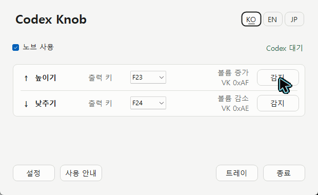
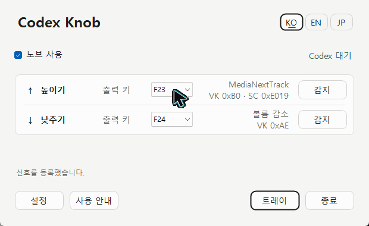

# Codex Knob

Windows에서 키보드 노브를 돌려 Codex의 추론 강도를 조절합니다. Microsoft Store에서 설치한 Codex가 활성 창일 때 입력을 변환합니다.

한국어 · [English](README.en.md)

## 설치

[Windows x64 설치 프로그램 다운로드](https://github.com/Gabeujin/codex-knob/releases/download/v1.2.0/Codex-Knob-1.2.0-Setup-x64.exe)

1. Codex Knob을 사용 중이라면 트레이에서 **종료**합니다.
2. 설치 프로그램을 실행합니다. .NET Framework 4.8 이상이 없으면 Microsoft 런타임을 내려받고 관리자 권한을 요청합니다. 재시작 안내가 나오면 Windows를 다시 시작한 뒤 설치 프로그램을 실행하세요.
3. 시작 메뉴에서 **Codex Knob**을 엽니다. 1.1.0에서 로그인 자동 시작을 사용했다면 앱에서 **설정 → 업데이트**를 눌러 연결을 옮기세요.

## 1. 노브 신호 감지

각 방향에서 **감지**를 누른 뒤 8초 안에 노브를 한 칸 돌립니다. 버튼 왼쪽에는 등록한 입력 이름과 Windows가 받은 값이 표시됩니다. 키 입력은 가상 키 코드(`VK`)와 스캔 코드(`SC`), 휠은 이동량(`Δ`)이 표시됩니다. 예전에 등록한 키의 스캔 코드를 보려면 다시 감지하세요.

## 2. 출력 키 선택과 Codex 연결

1. 방향별 **출력 키**를 F1~F24에서 고릅니다. 기본값은 높이기 **F23**, 낮추기 **F24**입니다. 이미 다른 장치에 배정한 키나 노브가 보내는 입력과 겹치면 다른 출력 키를 고르세요.
2. 앱의 **사용 안내**에서 선택한 키를 확인합니다.
3. Codex의 **설정 → 키보드 단축키**에서 **추론**을 검색합니다. 각 방향의 단축키 기록을 시작하고 노브를 해당 방향으로 한 칸 돌려 저장합니다. 채팅 입력창에서 양쪽 방향을 시험합니다.

GIF는 실제 앱 화면에서 Windows 테스트 입력으로 동작을 재현한 영상입니다. 같은 입력을 보내는 장치는 동일하게 처리됩니다. 휠을 등록하면 Codex에서 일반 마우스 스크롤도 바뀝니다.

## 소스 빌드

Windows PowerShell에서 `./build.ps1`을 실행합니다. 설치 프로그램은 Inno Setup 6.7에서 `ISCC.exe .\installer\CodexKnob.iss`로 빌드합니다.

[MIT 라이선스](LICENSE) · 독립 프로젝트
